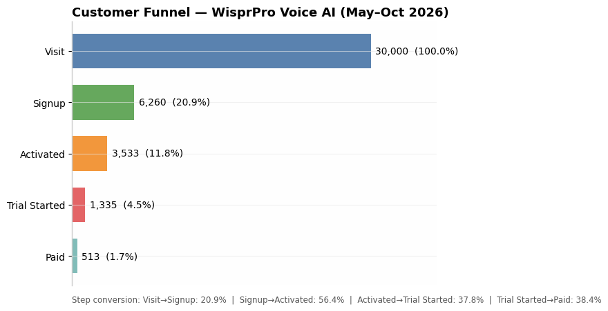
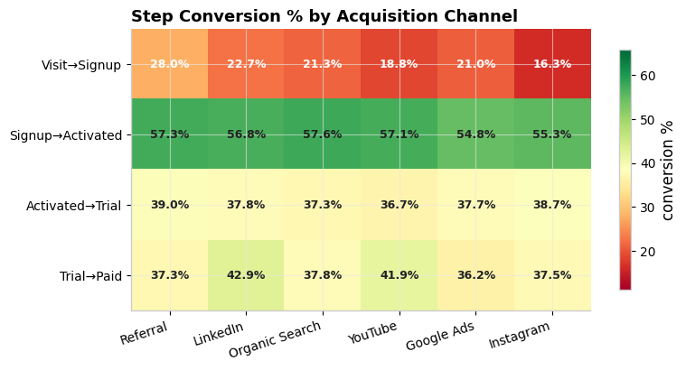
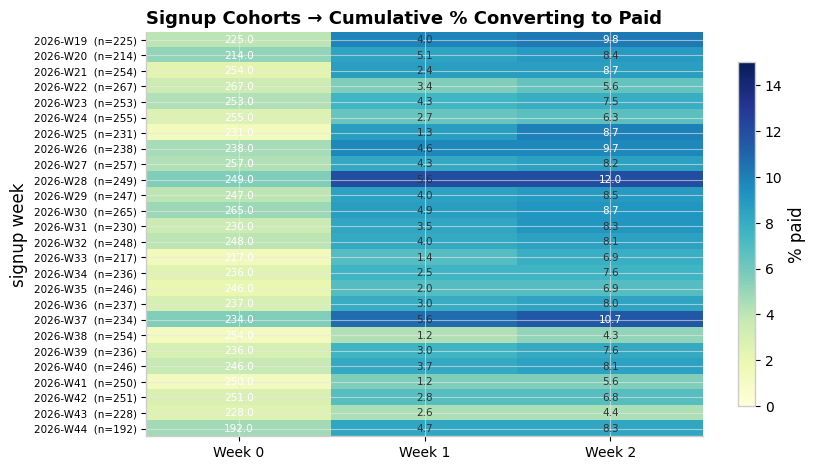
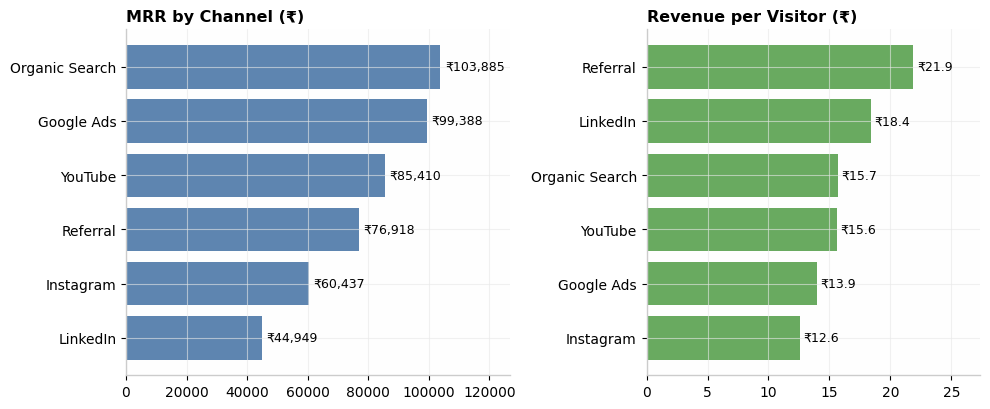

# Customer Funnel Intelligence — WisprPro

[](https://www.python.org) [](https://sqlite.org) [](https://openai.com) [](https://powerbi.microsoft.com)

End-to-end analytics project: from raw events to board-ready funnel insights.
Built as a hiring-challenge submission for WisprPro (India) — voice-AI SaaS growth analytics.

## The business question
Where do we lose users between first visit and paid subscription — and which channel,
device, and persona should we bet on next quarter?

## Headline findings (computed on 30,000 simulated users, May–Oct 2026)
| Stage | Users | Step conv. | Cumulative |
|---|---|---|---|
| Visit | 30,000 | — | 100% |
| Signup | 6,260 | 20.9% | 20.9% |
| Activated | 3,533 | 56.4% | 11.8% |
| Trial Started | 1,335 | 37.8% | 4.4% |
| Paid | 513 | 38.4% | **1.7%** |

- **MRR ₹470,987**; biggest leak is Visit→Signup (23,740 users lost)
- **Referral** is the quality channel: 2.33% visit→paid, **₹21.9 rev/visitor**
- **Instagram** is the weakest: 1.31% visit→paid — candidate for budget reallocation
- Monetisation bottleneck: Activated→Trial 37.8% and Trial→Paid 38.4%
- Full AI narrative in `reports/ai_insights.md`

## Dashboard previews (from `reports/figures/`)

**Overall funnel**


**Step conversion by channel**


**Signup cohort retention**


**Channel value: MRR and revenue per visitor**


## Stack map
| Challenge requirement | Where it lives |
|---|---|
| Python | `src/funnel_metrics.py`, `notebooks/funnel_analysis.ipynb`, 4 figures in `reports/figures/` |
| SQL | `sql/01–05*.sql` (funnel, segments, cohorts, drop-off, channel value) on `data/funnel.db` |
| LLM / GenAI | `src/genai_insights.py` — GPT-ready prompt layer with offline rule-based fallback |
| Power BI | `powerbi/POWERBI_GUIDE.md` — star schema, DAX measures, 4-page report spec |
| Git | Conventional repo layout, `.gitignore`, this README |

## Repo structure
```
customer-funnel-intelligence/
├── data/            # funnel.db (SQLite) + processed CSVs
├── sql/             # 5 analytical queries (run against funnel.db)
├── notebooks/       # funnel_analysis.ipynb
├── src/             # data gen, metrics lib, GenAI insight layer
├── powerbi/         # dashboard build guide + DAX
└── reports/         # figures, tables, funnel_metrics.json, ai_insights.md
```

## How to run
```bash
pip install -r requirements.txt
jupyter notebook notebooks/funnel_analysis.ipynb   # or: python src/genai_insights.py
sqlite3 data/funnel.db < sql/01_funnel_overall.sql
```
For live LLM insights: `export OPENAI_API_KEY=...` then `python src/genai_insights.py`.

## Methodology
1. Simulated funnel events with segment-dependent conversion probabilities (fixed seed 42)
2. Loaded into SQLite star schema; SQL answers the five analytical questions
3. Python validates SQL outputs and renders figures
4. GenAI layer turns `reports/funnel_metrics.json` into an executive narrative
5. Power BI guide operationalises the metrics as a dashboard

## Caveats & next steps
Synthetic data (no production access); next steps — connect real product events (Segment/RudderStack),
add spend data for true CAC/LTV, deploy the Power BI report, wire the insight bot to Slack.
